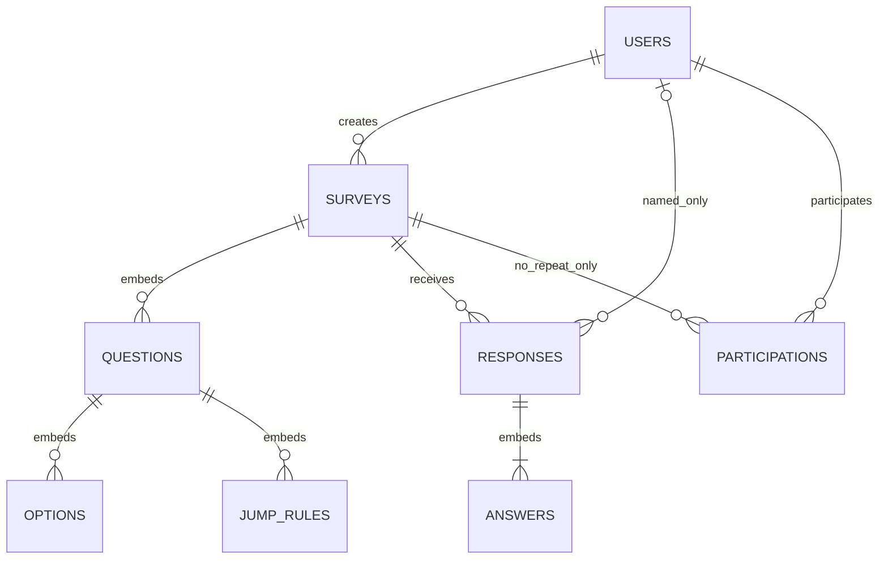

# 问序在线问卷系统数据库设计

数据库使用 `users`、`surveys`、`responses`、`participations` 四个业务集合，**题目整体嵌入问卷，答案整体嵌入答卷，账号参与记录与匿名答卷分开保存**。

本文的“数据库约束”指集合验证器或索引直接执行的约束；“业务约束”指后端检查和写入流程保证的规则。接口输入可以省略某些具有默认值的属性，但最终持久化文档仍必须满足数据库的必填要求。

## 1．定义与代码入口

验证器与索引源定义见 [init-mongodb.js](../01_代码/database/init-mongodb.js)，后端初始化读取同步的 [schema-definitions.json](../01_代码/database/schema-definitions.json)。字段输入见 [models.py](../01_代码/backend/app/models.py)，领域检查见 [domain.py](../01_代码/backend/app/domain.py)，数据库操作见 [service.py](../01_代码/backend/app/service.py)。

## 2．实体、集合及关系

### 2.1 集合与文档的对应关系

| 集合 | 一份顶层文档代表什么 | 内嵌内容 | 主要引用 |
|---|---|---|---|
| `users` | 一个用户账号 | 无 | 被问卷创建者、实名答卷、参与记录引用 |
| `surveys` | 一份问卷的完整定义 | 题目、选项、校验配置、跳转规则 | `ownerId → users._id` |
| `responses` | 一次成功提交的答卷 | 实际填写路径上的各题答案 | `surveyId → surveys._id`；实名时另有 `respondentId → users._id` |
| `participations` | 一个账号已经提交一份禁止重复填写的问卷 | 无 | `surveyId → surveys._id`、`userId → users._id` |

题目、选项、跳转规则和单题答案是业务实体，使用嵌套对象存储，不分别建立集合。集合由多份顶层 BSON（MongoDB 记录）组成，文档内部的对象和数组承载从属数据。



图中的 `QUESTIONS`、`OPTIONS`、`JUMP_RULES`、`ANSWERS` 表示内嵌实体，不是实际集合。草稿可以没有题目，发布时至少一道；每份已保存答卷至少包含一个实际经过题目的答案。参与记录与具体答卷之间没有引用字段。

### 2.2 选择 MongoDB 与嵌入、引用的理由

题目、选项、校验和跳转是嵌套结构，四种题型的属性与答案类型不同。MongoDB 的对象和数组与前后端处理形式一致，适合整份问卷、整份答卷的读写。若按规范化关系模型拆分题目、选项、规则和答案，需要更多关联查询与对象组装；本项目的访问方式以整卷为主，因此采用文档模型并结合引用。

| 设计选择 | 理由 |
|---|---|
| 题目嵌入问卷 | 展示、编辑和跳转需要完整定义，一次查询即可取得；数量有上限，发布后冻结 |
| 答卷独立保存 | 答卷持续增长，拆出后避免问卷文档膨胀，便于并发插入、分页和聚合 |
| 答案嵌入答卷 | 一次提交整体校验、整体保存，答案无需独立集合 |
| 用户独立引用 | 账号单点保存，不复制用户信息，也不在用户中维护不断增长的问卷/答卷数组 |
| 参与记录独立保存 | 禁止重复时核验账号资格，匿名答卷不直接保存账号或参与记录引用 |

发布后冻结定义使历史答案始终可由所属问卷解释；当前不复制题目快照，也不维护统计集合，减少冗余与同步负担。

## 3．通用数据约定与容量

### 3.1 BSON 类型与接口类型

| 类型或字段 | 数据库存储 | 后端及业务约定 |
|---|---|---|
| 顶层 `_id` 及跨集合引用 | BSON `objectId` | 由后端构造，API JSON 中序列化为 24 位十六进制字符串 |
| 题目、选项、规则 ID | BSON `string` | 匹配 `^[A-Za-z][A-Za-z0-9_-]{0,63}$`，1～64 字符，以英文字母开头；客户端提供稳定 ID，调整数组顺序时保持不变 |
| 计数、修订号及结构版本 | BSON `int` 或 `long` | 不接受布尔值充当整数；修订号请求范围为 1～`2^53−1` |
| 业务数值 | Schema 接受 `int`、`long`、`double`、`decimal` | 当前 API 接受严格的 Python 整数或浮点数，写入整数或双精度数；不提供 Decimal128 输入接口 |
| 日期 | BSON `date`，或声明可空的字段使用 `null` | UTC 存储；服务器时间及输入截止时间统一到毫秒精度。截止时间请求使用带时区的日期时间字符串，不接受数值时间戳 |
| 字符串长度 | Schema 的 `minLength`、`maxLength` | 按 Unicode 码点计算；标题、题干、说明、选项、文本答案去首尾空白后处理；密码保持原样 |
| 空值 | 仅允许显式声明可空的字段 | 无截止时间用 `null`；选填空答案用 `null`；匿名答卷直接省略 `respondentId`；未设置的校验上下限省略，不能显式传 `null` |

数值检查由后端进一步执行：拒绝 NaN、正负无穷及布尔值；JSON 整数不得超出 ±9,007,199,254,740,991。`integerOnly=true` 时，浮点形式的整数也必须处于该安全范围，保存前转为整数。普通数值题允许有限浮点值。

所有集合的顶层对象及 Schema 中声明的嵌套对象均使用 `additionalProperties:false`。数据库不会自动生成业务默认值；默认值由 Pydantic 模型和服务层补齐后写入。

### 3.2 容量上限

| 项目 | 数据库与应用采用的上限 |
|---|---:|
| 每份问卷题目数 | 100 |
| 每道选择题选项数 | 50 |
| 每道题跳转规则数 | 20 |
| 问卷标题 | 200 字符 |
| 问卷说明 | 5,000 字符 |
| 题干、题目说明 | 各 2,000 字符 |
| 单个选项文字 | 500 字符 |
| 单道文本答案 | 10,000 字符 |

MongoDB 单文档大小上限为 16 MiB。后端在创建、修改问卷和保存答卷前使用 BSON 编码检查最终大小，超过上限返回可读错误。HTTP 请求体还受配置项 `MAX_REQUEST_BYTES` 限制，默认 12 MiB；这项请求限制与单文档大小限制分别生效。

## 4．`users` 用户集合

### 4.1 完整字段

| 字段 | BSON 类型 | 持久化必填 | 数据库约束 | 后端含义及处理 |
|---|---|---|---|---|
| `_id` | `objectId` | 是 | 主键 | 后端生成 |
| `username` | `string` | 是 | 长度 3～32 | 显示用用户名；执行 NFKC 标准化及去首尾空白 |
| `usernameKey` | `string` | 是 | 长度 3～128；另有唯一索引 | 由标准化显示名转小写得到，作为登录查询键，不接收客户端自行指定 |
| `passwordHash` | `string` | 是 | 长度 1～1,024 | Argon2 密码哈希编码；不保存明文密码 |
| `createdAt` | `date` | 是 | 日期类型 | 注册时服务器生成 |
| `updatedAt` | `date` | 是 | 日期类型 | 注册时与 `createdAt` 同值；当前无账号编辑接口 |

用户名不能包含内部空白或 Unicode 控制类字符。标准化后的显示名必须仍满足 3～32 字符，登录键满足 3～128 字符。注册密码长度为 8～128 字符，密码不去空白、不转小写。

Schema 只检查哈希字段是字符串，不验证其是否真由 Argon2 生成；哈希算法和密码校验由服务层保证。账号查询响应排除 `passwordHash`，登录凭据不保存在本集合。

## 5．`surveys` 问卷集合

### 5.1 顶层字段

以下字段全部为持久化必填；可以为空的字段也必须显式保存 `null`。

| 字段 | BSON 类型 | 数据库约束 | 默认值、来源及业务约束 |
|---|---|---|---|
| `_id` | `objectId` | 主键 | 后端生成 |
| `ownerId` | `objectId` | 非空引用标识 | 当前登录用户 ID，创建后不变 |
| `publicId` | `string` | `^[0-9a-f]{32}$`；唯一索引 | 16 字节安全随机值的十六进制表示，用于分享链接；冲突时有限重试 |
| `title` | `string` | 长度 1～200 | 去首尾空白后必须非空 |
| `description` | `string` | 长度 0～5,000 | 默认为空字符串 |
| `status` | `string` | `draft`、`published`、`closed` | 创建时 `draft`，由状态操作改变 |
| `settings` | `object` | 必须含下表两个布尔字段 | 发布前确定，发布后整体锁定 |
| `deadlineAt` | `date` 或 `null` | 日期或空 | 默认 `null`；创建、设置或发布时必须仍晚于当前时间 |
| `questions` | `array` | 0～100 个符合题型 Schema 的题目 | 草稿可以为空；发布至少一道；数组顺序表示题目顺序 |
| `schemaVersion` | `int` 或 `long` | 枚举值 `1` | 文档结构版本，当前固定为 1 |
| `revision` | `int` 或 `long` | 最小值 1 | 初始为 1；更新及成功新提交时递增，用于条件写入和并发协调 |
| `createdAt` | `date` | 日期类型 | 创建时间，之后不变 |
| `updatedAt` | `date` | 日期类型 | 最近一次对问卷文档进行业务更新的时间 |
| `publishedAt` | `date` 或 `null` | 日期或空 | 草稿为 `null`；首次发布时由服务器赋值 |
| `closedAt` | `date` 或 `null` | 日期或空 | 未关闭为 `null`；手动关闭使用服务器时间，截止关闭使用当前文档的 `deadlineAt` |
| `closeReason` | `string` 或 `null` | `null`、`manual`、`deadline` | 未关闭为 `null`，关闭时写入相应原因 |

`settings` 对象只包含：

| 字段 | 类型 | 持久化必填 | 业务含义 |
|---|---|---|---|
| `anonymous` | `bool` | 是 | 创建请求必须明确指定，决定整份问卷统一匿名或实名，填写者不能切换 |
| `allowRepeat` | `bool` | 是 | 请求省略时默认 `false`，同账号是否允许主动提交多份答卷 |

### 5.2 题目公共结构

`questions` 每个元素按 `type` 选择四种互斥结构之一：`single`、`multiple`、`text`、`number`。下表的“必填”指写入数据库后的结构。

| 字段 | 类型 | 必填 | 约束及默认值 |
|---|---|---|---|
| `id` | `string` | 是 | 稳定 ID；同一问卷内不可重复 |
| `type` | `string` | 是 | 四种题型之一，决定合法的选项、校验和条件结构 |
| `title` | `string` | 是 | 去首尾空白后 1～2,000 字符 |
| `description` | `string` | 是 | 0～2,000 字符，请求默认空串 |
| `required` | `bool` | 是 | 请求默认 `true` |
| `validation` | `object` | 是 | 按题型定义，请求可省略，由模型补齐；未设置的上下限不入库 |
| `options` | `array` | 仅单选、多选必须 | 2～50 个选项；文本和数字题禁止出现该字段 |
| `jumpRules` | `array` | 是 | 请求默认空数组；选择和数字题最多 20 条；文本题必须为空数组 |

题目顺序由 `questions` 数组位置决定，不保存重复的 `order` 字段。题目 ID 的内部唯一性由后端保证，当前集合验证器没有为这一属性编写跨元素表达式。

### 5.3 选项结构

每个选项只包含两个字段，均必填：

| 字段 | BSON 类型 | 约束 |
|---|---|---|
| `id` | `string` | 稳定 ID；同一题目内不可重复 |
| `label` | `string` | 去首尾空白后 1～500 字符；后端拒绝同题重复文字 |

选项显示顺序由数组位置决定。答案和跳转条件引用选项 ID，不引用选项文字或位置。不同题目可以使用相同选项 ID，不同题目内的选项不互相混用。

### 5.4 各题型的 `validation`

| 题型 | 字段 | BSON 类型 | 必填及取值范围 | 后端关联检查 |
|---|---|---|---|---|
| 单选 `single` | 无字段 | 空对象 | 必须为 `{}` | 必答由题目的 `required` 决定 |
| 多选 `multiple` | `minSelections` | `int` 或 `long` | 可选，0～50；省略按 0 处理 | 不得超过选项数；不得大于有效上限 |
| 多选 `multiple` | `maxSelections` | `int` 或 `long` | 可选，0～50；省略按选项数处理 | 不得超过选项数；必答题至少允许选择一项 |
| 文本 `text` | `minLength` | `int` 或 `long` | 可选，0～10,000；省略按 0 处理 | 不得大于有效上限 |
| 文本 `text` | `maxLength` | `int` 或 `long` | 可选，0～10,000；省略按 10,000 处理 | 必答文本题不能配置为 0 |
| 数字 `number` | `integerOnly` | `bool` | 持久化必填，请求默认 `false` | 为真时只能填写安全范围内整数 |
| 数字 `number` | `min` | 数值类型 | 可选；应用要求有限数字 | 同时设置时必须 `min ≤ max` |
| 数字 `number` | `max` | 数值类型 | 可选；应用要求有限数字 | 整数模式范围内至少存在一个安全整数 |

“恰好选择 N 项”通过 `minSelections=maxSelections=N` 表达。必答多选的有效最小数量至少为 1；必答文本的有效最小长度至少为 1。

选填题留空时不执行选择数量、文本长度、数值上下限检查；一旦给出非空答案，则执行全部配置。因此“选填且最少选择 2 项”的含义是允许不选，选择后至少两项。

### 5.5 跳转规则结构

每条规则只包含以下必填字段：

| 字段 | 类型 | 约束 |
|---|---|---|
| `id` | `string` | 稳定 ID；在所属题目内唯一 |
| `condition` | `object` | 只能使用所属题型允许的操作符和属性 |
| `target` | `object` | 只能是后续题目或结束目标 |

条件对象的完整字段如下：

| 所属题型 | 合法条件结构 | 额外业务检查 |
|---|---|---|
| 单选 | `{operator:"eq", value:"opt_a"}` | `value` 必须是本题有效选项 ID |
| 多选 | `{operator:"containsAny", values:["opt_a"]}` | `values` 长度 1～50，无重复，全部属于本题 |
| 多选 | `{operator:"containsAll", values:["opt_a","opt_b"]}` | 同上，要求包含指定全部选项 |
| 多选 | `{operator:"setEquals", values:["opt_a","opt_b"]}` | 同上，与指定集合相同，忽略选择顺序 |
| 数字 | `{operator:"gt"或"gte"或"lt"或"lte"或"eq", value:数字}` | `value` 经过有限数及整数输入安全范围检查 |
| 数字 | `{operator:"between", min:数字, max:数字}` | 闭区间，必须 `min ≤ max` |

表中对象的全部属性均必填，且禁止额外字段。多选条件数组同时受数据库 `uniqueItems:true` 和后端重复检查约束，后端保存前按本题选项顺序规范化。

跳转目标只有两种：

```javascript
{ kind: "question", questionId: "q3" }
{ kind: "end" }
```

`kind="question"` 时必须有 `questionId`，且目标在同一问卷中、位于当前题目之后。`kind="end"` 时禁止额外附带 `questionId`。文本题的 `jumpRules` 只能为空。

规则数组顺序就是优先级，第一条命中后执行。空答案不匹配任何条件；没有命中则进入顺序下一题，最后一题之后结束。结束表示进入提交确认阶段，不会自动写入答卷。规则只判断所属题目，不支持跨题组合表达式或执行任意代码。

### 5.6 状态与版本字段

`draft → published → closed`，发布后冻结题目结构和填写设置。`revision` 用于条件更新与并发协调，编辑、发布、关闭和成功新提交均可能递增；`schemaVersion` 表示文档结构版本，二者都不是问卷内容历史版本。状态与日期的关联、截止处理由服务层保证，算法见 [关键逻辑说明](04_关键逻辑说明.md)。完整四题型问卷请求见 [API 示例](03_API说明.md)。

## 6．`responses` 答卷集合

### 6.1 顶层字段

| 字段 | BSON 类型 | 持久化必填 | 数据库约束与业务含义 |
|---|---|---|---|
| `_id` | `objectId` | 是 | 一次成功提交的唯一标识 |
| `surveyId` | `objectId` | 是 | 所属问卷 ID |
| `respondentId` | `objectId` | Schema 可选 | 业务上实名必须保存、匿名必须省略；不允许保存为 `null` |
| `submissionKey` | `string` | 是 | 匹配 `^[0-9a-f]{64}$`；32 字节安全随机值的十六进制表示，同一次填写重试保持不变 |
| `answers` | `array` | 是 | 1～100 个单题答案，按服务端计算的实际经过顺序保存 |
| `submittedAt` | `date` | 是 | 请求进入服务器时记录的时间，也是截止判断使用的时间 |
| `schemaVersion` | `int` 或 `long` | 是 | 固定为 `1` |

一份文档表示一次完整、成功的提交。当前不保存未提交草稿，不支持提交后修改或撤回。答卷不复制完整问卷定义，也不保存用户名、IP、设备信息、参与记录 ID 或提交 token。

### 6.2 单题答案与空值

`answers` 每个元素只能包含 `questionId`、`value`，二者均必填：

| 字段 | 数据库约束 | 后端检查 |
|---|---|---|
| `questionId` | 稳定 ID 字符串 | 必须属于所属问卷；同答卷不能重复；必须位于实际填写路径 |
| `value` | `null`、1～10,000 字符的字符串、1～50 个不重复稳定 ID 的数组、或数值类型之一 | 根据实际题型确定合法类型、选项、长度、数量、范围及必答规则 |

Schema 中的字符串分支同时服务单选和文本，因此数据库层不会判断某个字符串是否真是有效选项；数值分支也不会自动读取问卷的整数设置。具体语义由 `validate_submission` 保证。

| 题型或填写情况 | 实际保存的 `value` |
|---|---|
| 单选 | 本题的一个有效选项 ID |
| 多选 | 本题有效选项 ID 数组；无重复，按本题选项顺序规范化 |
| 文本 | 去首尾空白后的非空字符串，满足题目长度设置 |
| 数字 | 有限数值，满足本题范围和整数设置 |
| 实际经过但留空的选填题 | `null`，不保存空字符串、纯空白或空数组 |
| 被跳过的题目 | 不生成该题答案元素 |

提交请求中省略实际路径上的选填题时，后端仍会补齐对应的 `null`；省略必答题会失败。后端从第一题开始执行规则，构造完整路径，并拒绝未知、重复或路径外答案；不直接信任前端上传的题目顺序。

### 6.3 匿名答卷示例

以下答卷对应 [API 创建示例](03_API说明.md)；第一题选择“否”跳过 `q2`：

```javascript
{
  _id: ObjectId("000000000000000000000020"),
  surveyId: ObjectId("000000000000000000000010"),
  submissionKey: "a1b2c3d4e5f60718293a4b5c6d7e8f90112233445566778899aabbccddeeff00",
  answers: [
    { questionId: "q1", value: "no" },
    { questionId: "q3", value: 6.5 },
    { questionId: "q4", value: null }
  ],
  submittedAt: ISODate("2026-10-19T04:00:00.000Z"),
  schemaVersion: NumberInt(1)
}
```

实名答卷采用同一结构，额外保存当前填写者的 `respondentId`。答卷管理接口会临时查询用户名并返回 `respondentName`，该显示属性不写入答卷文档；匿名答卷没有这两个身份属性。

## 7．`participations` 参与记录集合

仅对 `allowRepeat=false` 的问卷创建参与记录，匿名和实名都使用同一套资格限制。

| 字段 | BSON 类型 | 持久化必填 | 约束及含义 |
|---|---|---|---|
| `_id` | `objectId` | 是 | 记录主键 |
| `surveyId` | `objectId` | 是 | 已成功提交的问卷 |
| `userId` | `objectId` | 是 | 本次成功提交的登录账号 |

```javascript
{
  _id: ObjectId("000000000000000000000030"),
  surveyId: ObjectId("000000000000000000000010"),
  userId: ObjectId("000000000000000000000002")
}
```

该对象禁止额外字段，不保存 `responseId`、`submissionKey`、答案、设备信息或独立的提交时间。允许重复填写时不创建参与记录；禁止重复时，同一 `surveyId + userId` 只能存在一份记录。参与记录只有在整个提交事务成功时才生效，失败不会占用填写资格。

## 8．索引定义与查询依据

四集合各有默认 `_id_` 唯一索引，另有下列六个业务索引，共十个。复合键顺序和方向属于定义的一部分。

| 集合 | 完整 key | name | unique |
|---|---|---|---|
| `users` | `{usernameKey:1}` | `uq_users_usernameKey` | `true` |
| `surveys` | `{publicId:1}` | `uq_surveys_publicId` | `true` |
| `surveys` | `{ownerId:1,createdAt:-1,_id:-1}` | `ix_surveys_owner_created` | 未声明，默认 `false` |
| `responses` | `{surveyId:1,submittedAt:-1,_id:-1}` | `ix_responses_survey_submitted` | 未声明，默认 `false` |
| `responses` | `{surveyId:1,submissionKey:1}` | `uq_responses_survey_submission` | `true` |
| `participations` | `{surveyId:1,userId:1}` | `uq_participations_survey_user` | `true` |

### 索引用途与限制

- `usernameKey` 唯一索引防止大小写及标准化后重复的用户名；统一键的生成仍由后端负责。
- `publicId` 唯一索引用于分享地址定位问卷。
- 问卷所有者复合索引支持“我的问卷”按创建时间倒序；`_id` 作为同时间下的排序补充键。
- 答卷复合索引支持按问卷、提交时间及 `_id` 排序查询；当前接口使用页码和 `skip/limit` 分页。其 `surveyId` 前缀也服务于统计前的问卷过滤。
- 提交 key 唯一索引防止一次填写的双击或网络重试保存多份答卷；参与组合唯一索引防止同账号通过并发请求绕过禁止重复设置。两者解决不同问题。
- 当前没有为状态、标题搜索、每个选项答案或所有嵌套字段分别建索引。标题搜索由后端转义为字面关键词后执行不区分大小写的匹配，不能把它描述为专用全文索引。
- 不建立 TTL 索引；截止问卷只关闭，不删除历史数据。也不在答卷上建立无条件的 `surveyId + respondentId` 唯一索引，因为匿名没有该字段，实名也可能允许多次填写。

数组内属性的唯一性不能由这些复合唯一索引保证。`uniqueItems:true` 只用于答案选项 ID 数组和多选条件 ID 数组；题目 ID、同题选项 ID、同题规则 ID、同答卷题目 ID 的唯一性由后端逐项检查。

## 9．Schema、唯一索引和业务校验的边界

集合验证器使用 `$jsonSchema`、`bsonType`、`required`、`additionalProperties:false`、`oneOf`、`enum`、长度与数组容量限制等，统一设置 `validationLevel:"strict"`、`validationAction:"error"`。

| 规则 | 数据库直接保证 | 后端补充保证 |
|---|---|---|
| 字段类型、必填、枚举、长度、容量、禁止额外字段 | Schema | 提前返回可读错误，并补齐默认值 |
| 用户名键、分享标识、提交组合、参与组合唯一 | 唯一索引 | 生成安全随机值、规范化键、捕获重复键并解释 |
| 多选答案和条件 ID 数组没有重复项 | `uniqueItems:true` | 再次检查并按选项顺序规范化 |
| 嵌套实体的 ID 唯一、同题选项文字不重复 | 当前 Schema 未表达 | `validate_questions`、答案映射检查 |
| 最小值不超过最大值、选择数量不超过选项数 | 当前 Schema 只限制各字段自身范围 | 题型关联校验 |
| 数值有限、整数精度、空白标准化 | 当前数值 Schema 只限制 BSON 类型 | 严格输入及答案标准化 |
| 用户和问卷引用存在、选项和跳转目标属于当前题目或问卷 | 无外键自动检查 | 认证查询、资源加载、配置及路径检查 |
| 发布至少一道题、状态与时间相容、发布后锁定 | Schema 不比较状态变化前后 | 状态操作、未来时间检查、条件更新 |
| 匿名省略身份、仅禁止重复时创建参与记录 | Schema 不读取另一集合设置 | 提交服务构造文档 |
| 答卷与参与记录同时成功、并发关闭有一致先后顺序 | 单个验证器或唯一索引不足 | 多文档事务与问卷条件写入 |
| 只能管理自己问卷、答卷不可修改或撤回 | Schema 不是访问授权 | API 权限检查及接口范围 |

因此，直接在数据库写入一个“通过 Schema 的文档”，不代表它已经满足问卷业务规则。例如 Schema 允许 `responses.respondentId` 缺省，但不会自行判断所属问卷是否实名；也允许问卷题目数组为空，但业务层禁止发布空问卷。

当前开发脚本创建的是绑定本机地址的副本集，没有创建 MongoDB 认证用户或自动配置细粒度角色。业务权限由 API 执行；数据库账号、访问网络及能否绕过验证器属于部署环境配置，不能写成初始化脚本已经完成的能力。

## 10．一致性、匿名与派生数据

所有新答卷均通过副本集事务保存。服务端在同一事务中条件更新问卷、按需插入参与记录并插入答卷；失败整体回滚。问卷条件写入协调提交与手动关闭的先后，`surveyId + submissionKey` 唯一索引处理同次重试，`surveyId + userId` 唯一索引限制账号重复参与。完整顺序、截止前在途请求和凭据校验见 [关键逻辑说明](04_关键逻辑说明.md)。

匿名问卷仍需登录，`responses` 省略 `respondentId`；禁止重复时的参与记录只关联账号与问卷，不指向答卷。填写 token 不入库，随机 key 不由账号推导。该设计避免答卷直接关联账号，但时间、日志和用户主动填写的身份信息仍可能用于推断身份。

以下字段仅在查询时计算，不写入 Schema：

| 派生字段 | 来源 |
|---|---|
| `questionCount` | 题目数组长度 |
| `responseCount`、`totalResponses` | 成功答卷数量 |
| `canSubmit` | 重复设置及当前账号参与记录 |
| `respondentName` | 实名答卷查询时读取用户名 |
| `answeredCount`、选项 `count`、`average`、`values` | 答案聚合及单题内容分页 |

## 11．初始化与结构维护

[bootstrap.py](../01_代码/backend/app/bootstrap.py) 对新集合创建验证器，对已有集合执行 `collMod`，再确认索引；启动时检查副本集。安装、初始化及 Schema 同步命令见 [项目 README](../README.md) 与 [后端 README](../01_代码/backend/README.md)。普通运行读取附带 JSON，无需 Node.js；修改 Schema 时需同步两份定义。

初始化不插入账号或答卷，不自动修复历史数据；旧数据重复可能导致唯一索引创建失败。`surveys`、`responses` 的 `schemaVersion` 当前固定为 1，其他两集合无此字段。后续变更需另行制定兼容与迁移方案；若允许发布后修改题目，还需设计内容版本和历史答案解释方式。
