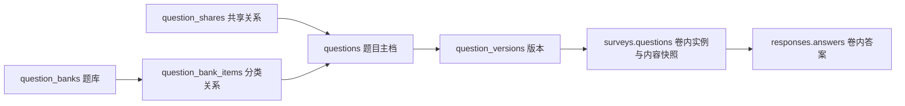

# 问序新版数据模型设计草案

整理日期：2026-10-22。

状态：基于[已定稿业务规则](06_新版业务规则.md)保留的模型设计。原四集合的结构与约束见[第一阶段数据库设计](02_数据库设计.md)。该模型及验证器、索引现已在 2.2 实现，相关实现见[基础流程实现说明](09_基础流程实现说明.md)；旧结构转换使用[显式迁移工具](12_旧问卷显式迁移说明.md)，本轮未对日常开发库执行迁移。

## 1. 建模方案

保留 `users`、`surveys`、`responses`、`participations`，题目功能新增五个集合，共九个业务集合。为管理写请求提供可靠幂等，另增请求回执与大响应分片两个基础设施集合，目标共十一个集合。

| 新增集合 | 一份文档代表什么 | 采用独立集合的理由 |
|---|---|---|
| `questions` | 一道题的身份、归属、版本指针和来源 | 多问卷、题库、共享和版本均引用同一身份 |
| `question_versions` | 一个正式保存的题目版本 | 内容不可覆盖，版本持续增长，需独立分页和追溯 |
| `question_shares` | 一道题对一个用户的共享关系 | 独立授权与撤权，覆盖该题所有版本 |
| `question_banks` | 一个用户的个人题库 | 管理分类容器，不承担题目授权 |
| `question_bank_items` | 一道题加入一个题库的分类关系 | 支持同题多库，不复制题目，也不维护无限增长的数组 |

问卷继续嵌入完整卷内实例。实例保存固定版本引用及由服务端生成的内容快照，答卷继续嵌入答案。



快照包含正式版本中的题型、题干、说明、选项和校验限制。该冗余用于固定问卷内容和减少填写时的关联读取；它不产生新的题目身份，也不能由客户端修改。共享撤销或版本归档后，已有问卷凭快照继续发布、填写和解释历史答案。

## 2. 标识与版本的区分

| 标识 | 范围与用途 |
|---|---|
| `questions._id` | 库级题目身份，BSON ObjectId |
| `question_versions._id` | 库级版本身份，BSON ObjectId |
| `question_versions.versionNo` | 同一题目内的版本序号，如 1、2、3 |
| `surveys.questions[].id` | 问卷内的稳定实例 ID，沿用现有字符串格式 |
| `responses.answers[].questionId` | 沿用现有含义，指所属问卷内实例的 `id` |
| `jumpRules[].target.questionId` | 沿用现有含义，指同一问卷后方实例的 `id` |
| `surveys.revision` | 问卷并发协调号，不是题目内容版本 |
| `schemaVersion` | 所在文档的数据结构版本，不是内容版本 |

库级 ObjectId 在接口中以 24 位十六进制字符串表示，使用独立输入类型，不能复用当前要求首字符为字母的 `StableId`。跨卷答案映射必须使用 `(surveyId, 卷内实例 id)`，不能假设不同问卷的实例 ID 全局唯一。

## 3. 新增集合字段

以下为推荐字段；实现时需补齐严格的类型、必填、长度和容量定义，不将本表视为已经生效的 Schema。

### 3.1 `questions`：题目主档

| 字段 | 含义 |
|---|---|
| `_id`、`ownerId` | 题目身份和唯一所有者 |
| `latestVersionId` | 最近创建的版本；不表示所有问卷应当跟随它 |
| `versionSeq` | 已分配的最大版本序号，用于事务内分配新序号 |
| `origin` | `original`、`copy` 或 `legacy` 类型的来源对象 |
| `revision` | 所有者管理题目/版本归档、保存新版本、恢复、授权和撤权时的统一并发协调号 |
| `guardRevision` | 内部事务协调号，用于新增使用与撤权、归档之间的写冲突 |
| `archivedAt` | 题目归档时间，未归档为 `null` |
| `createdAt`、`updatedAt` | 创建时间和题目管理更新时间 |

`origin` 按类型分别保存：

- `original`：独立新建，没有来源引用。
- `copy`：来源题目的 `questionId` 和来源版本的 `versionId`，由后端从已授权版本生成。
- `legacy`：来源旧问卷的 `surveyId` 和卷内 `instanceId`，用于显式迁移的追溯及幂等检查。

来源关系不授予源题访问权限。查询副本来源时不能绕过原题权限检查。`guardRevision` 不作为引用数量或用户可见修订号，其内部递增不更新题目内容或管理更新时间。

### 3.2 `question_versions`：正式版本

| 字段 | 含义 |
|---|---|
| `_id`、`questionId`、`versionNo` | 版本身份、所属题目和版本序号 |
| `baseVersionId` | 内容来源版本；同题内引用，首版为 `null` |
| `operation` | `create`、`edit`、`restore`、`copy` 或 `migrate` |
| `content` | 题型、题干、说明、选项和校验限制，不含必答、顺序或跳转 |
| `createdBy`、`createdAt` | 创建者和创建时间，由服务端生成 |
| `archivedAt` | 版本归档时间，未归档为 `null` |

版本序号表示创建顺序，`baseVersionId` 表示内容来源，两者不混用。例如，从 v1 编辑或恢复生成 v4，来源均可指向 v1，`operation` 区分两种操作。恢复请求只指定来源版本，由后端复制内容，不接受夹带的替代内容。

独立副本的首版没有同题内的父版本，其跨题来源保存在新题的 `origin` 中。

除专用归档操作修改 `archivedAt` 外，版本的内容、归属、编号、来源、创建者和创建时间均不可更新。不提供覆盖版本内容的接口。集合验证器负责结构，不能比较更新前后的内容；不可覆盖规则还必须由服务层的写入白名单保证。

### 3.3 `question_shares`：整题共享

| 字段 | 含义 |
|---|---|
| `_id`、`questionId`、`recipientId` | 共享关系、题目和接收者 |
| `grantedBy` | 授权者，必须为该题所有者 |
| `grantedAt`、`revokedAt` | 最近授权时间及撤权时间；有效授权的 `revokedAt` 为 `null` |
| `revision` | 授权关系的并发协调号 |
| `createdAt`、`updatedAt` | 关系首次创建及最近变更时间 |

同一题目与同一接收者仅有一份关系，撤权后重新授权更新该关系。授权不保存版本清单；有效期间覆盖该题全部可使用版本及后续新版本。该关系的修订号为内部条件更新字段，客户端管理操作统一提交父题修订号。完整授权事件审计不属于当前已确定功能，不将这一关系表描述为事件日志。

### 3.4 个人题库与分类关系

`question_banks` 保存 `_id`、`ownerId`、`name`、`description`、`revision`、内部 `guardRevision`、`createdAt` 和 `updatedAt`。

`question_bank_items` 保存 `_id`、`bankId`、`questionId` 和 `createdAt`。分类引用题目身份，选题时再选择具体版本。

题库公开 `revision` 仅用于名称、说明管理及删除前的条件检查；成员增删不递增此号，使用内部 `guardRevision` 与删库操作协调。

所有分类操作先检查题库所有者。分类记录不授予题目访问权；即使分类关系仍存在，题目授权撤销后也不能据此浏览完整版本或新增选用。删除题库仅删除题库及其分类关系。

### 3.5 `mutation_receipts`：管理请求成功回执

| 字段 | 含义 |
|---|---|
| `_id`、`actorId`、`key` | 回执身份、调用者和 `Idempotency-Key` |
| `operationId`、`target` | 操作名称及规范化目标，不能把同一键用于其他操作或对象 |
| `canonicalVersion`、`fingerprint` | 请求规范化算法版本和 SHA-256 摘要，包含原始预期修订号 |
| `status` | 事务内先占用为 `processing`，完成后更新为 `succeeded`；正常提交不允许留下 processing |
| `resultRefs` | 已创建或已操作的资源 ID，恢复操作包含实际生成的版本 ID |
| `httpStatus`、`response` | 原成功状态码和已序列化 JSON 响应的存储信息 |
| `createdAt`、`completedAt` | 服务端记录的处理时间 |

唯一索引为 `(actorId,key)`。同一调用者的键在管理写接口之间全局唯一；操作、目标或规范化参数不同则返回键复用冲突。

未来升级规范化规则时，同键重放按回执记录的 `canonicalVersion` 和对应输入约定解释，继续支持旧版本算法，不能用最新默认值重新计算所有历史请求。

键占用、业务写入、回执成功状态及响应保存必须在同一事务中完成。失败或进程中断不能留下已提交的 processing 行或脱离业务变更的成功回执。幂等重放读取回执必须先于当前资源状态和 revision 检查；调用者仍需正常登录。

回执确认的是同一调用者原来已完成的操作，不授予当前源题访问权。重放另存结果时返回已创建的独立副本响应，不重新读取或授权原题。响应可能是历史状态，客户端后续管理前重新 GET 当前资源。

本次不为回执设置 TTL，也不删除已用键后允许重做旧请求。明确回滚的失败不缓存为成功；提交结果不明时保留原键继续确认，不能按“暂时未读到回执”认定第一次没有成功。

### 3.6 `mutation_response_chunks`：大响应分片

回执不能直接嵌入接近 MongoDB 16 MiB 上限的完整问卷响应。推荐已序列化响应不超过 256 KiB 时以内联 BSON Binary 保存；超过时按最多 256 KiB 的字节块写入本集合。

分片保存 `_id,receiptId,index,data`，以 `(receiptId,index)` 唯一；回执的 `response` 保存模式、分片数量、总字节数和内容 SHA-256。分片、回执与业务写入在同一事务提交。重放只读取原回执对应分片，不从当前业务对象重新拼出“第一次响应”。

不保存 Authorization、Cookie、填写凭据等请求头，不将回执或分片作为公开查询资源。分片同样不单独设 TTL；完整性校验失败时不得重做业务来补响应。

## 4. 问卷与答卷结构

### 4.1 新问卷写入结构版本 2

保留原问卷字段与状态机，`surveys.schemaVersion` 新增值 `2`。每个卷内实例保留原有题目形状，追加库级引用及服务端复制的版本号：

```javascript
{
  id: "q_age",                            // 卷内 ID：答案和跳转继续引用它
  questionId: ObjectId("000000000000000000000101"),
  versionId: ObjectId("000000000000000000000102"),
  versionNo: 1,                           // 服务端复制，用于历史版本展示
  type: "number",                         // 以下内容字段是版本快照
  title: "你的年龄",
  description: "",
  validation: { integerOnly: true, min: 0, max: 150 },
  required: true,                         // 卷内设置
  jumpRules: []                           // 卷内设置；位置由数组顺序表达
}
```

保持扁平快照有利于复用现有填写、跳转和答案校验代码。新版本的内容必须满足既有题型规则；装入具体问卷后，还需结合该实例的 `required` 和跳转规则进行整卷校验。

读取 DTO 与保存 DTO 分开：保存仅接收 `id`、`questionId`、`versionId`、`required` 和 `jumpRules`，数组表达顺序。快照、版本号、所有者和授权结论均由后端生成，不信任客户端回传。

同时检查卷内 `id` 唯一和库级 `questionId` 唯一；后者落实同卷同题最多一次，即使传入不同版本也拒绝。

### 4.2 答卷保持现有结构

`responses` 的答案结构不变，继续使用 `answers[].questionId` 指卷内实例。因此答卷可继续保持 `schemaVersion=1`，无需为每份答卷重复写库级题目引用。

问卷结构版本与答卷结构版本独立，不要求数值相等。原提交 key、幂等重试、匿名身份分离、参与资格和提交事务语义继续保留。

## 5. 保存、撤权和归档的事务边界

### 5.1 已有引用由数据库事实认定

保存草稿时，以当前持久化问卷为准，按 `(卷内 id, questionId, versionId)` 比较：

- 完全一致的引用：复用原存储快照，可以修改合法的必答、顺序和跳转设置，不重新要求当前共享授权。
- 新增实例或替换版本：检查当前使用权限、题目和版本可选状态、版本所属题目，再由后端复制快照。
- 复制问卷、另存题目：属于新的使用，不能继承旧问卷的豁免。
- 已删除并保存的实例再次加入：属于新增使用，不能凭旧请求中的 ID 恢复授权。

保留现有问卷 `revision` 条件写入，并在事务内完成引用检查与问卷保存。发布已保存草稿只验证其完整快照及卷内配置，不重新要求源题共享仍有效。

### 5.2 新增使用与撤权必须协调提交顺序

仅在事务里读取共享状态，不能保证它在保存时仍有效；事务可能读到旧快照。MongoDB 官方说明了事务旧读，以及通过实际修改文档建立锁定和写冲突的方式。[MongoDB 事务说明](https://www.mongodb.com/docs/manual/core/transactions-production-consideration/#in-progress-transactions-and-stale-reads)

推荐统一以题目主档的内部 `guardRevision` 建立协调点：

1. 新增引用、换版、另存副本时，在同一事务内对题目主档执行真实 `$inc`，检查当前权限及相关归档状态，再保存结果。
2. 授权、撤权、题目归档、版本归档时，在变更相关记录的同一事务内，也对该题目主档执行真实 `$inc`。
3. 冲突后整体重试，从数据库重新读取权限。撤权先提交则新增使用失败；新增使用先提交则成为被保留的既有使用。
4. 不用可能不改变值的 `$set` 代替真实递增，也不把事务开始前的授权结果带入重试。
5. 一次操作涉及多道题时，按稳定的题目 ID 顺序访问协调点，减少相互竞争。

此方案会使同一道题的新增使用互相协调，适合本次项目规模。内部编号只用于并发一致性，不作为产品字段展示。

### 5.3 其他原子边界

| 操作 | 同一事务中的写入 |
|---|---|
| 首次建题 | 题目主档与首版，保证不存在缺少首版的题目 |
| 保存新版本、恢复旧版 | 分配版本号、插入版本、更新 `latestVersionId` 与主档修订号 |
| 另存为独立题目 | 源题新增使用检查、新题主档、来源信息与新题首版 |
| 授权或撤权 | 授权关系变更、源题协调号递增 |
| 版本归档 | 版本归档元信息、父题协调号递增 |
| 新增题库分类 | 检查题库所有者及题目访问权、写题库协调点、插入分类关系 |
| 删除题库 | 删除题库与全部分类关系；与分类新增通过同一题库主档发生写冲突 |

版本创建同时检查主档修订号，以唯一索引兜底版本序号冲突；不得先在事务外读取最大版本号再直接加一。

### 5.4 管理请求幂等事务

以下流程包裹前述管理写入，不嵌套启动事务：

事务使用 primary、`readConcern:snapshot` 和 `writeConcern:majority`，并配合部署的日志持久化设置；提交确认和回执查询走 primary/majority 一致性。不能将主节点切换前的 `w:1` 确认等同于这一提交保证。

1. 登录鉴权、校验请求结构与幂等键，计算请求摘要。若找到本人同键成功回执，参数一致则返回原成功结果，参数不同则拒绝。
2. 没有回执时进入事务，首先占用 `(actorId,key)` 唯一键，随后才检查当前 revision、权限和业务状态并执行业务写入。
3. 生成成功响应，在同一事务保存回执及必要分片，更新回执为 succeeded，确认提交后才发送 HTTP 响应。
4. 并发同键在唯一键上协调；冲突后先退出失败事务，再用新的读取视图查询成功回执，不能继续用旧快照执行业务。
5. 明确中止则业务、键占用与分片一起回滚。提交结果不明时由驱动确认/重试提交，仍无法确认则返回可重试的未知结果，客户端沿用同键。

PyMongo 的事务回调可能被重试，因此回调内不能发送 HTTP 成功、修改外部状态或将一次回调执行误认为已提交。实现依据见[PyMongo 事务说明](https://www.mongodb.com/docs/languages/python/pymongo-driver/current/crud/transactions/)。

## 6. 索引与约束

保留既有六个业务索引。各新增集合仍有默认 `_id` 唯一索引，另推荐下列索引：

| 集合 | 索引键 | 是否唯一 | 用途 |
|---|---|---|---|
| `questions` | `ownerId, archivedAt, updatedAt desc, _id desc` | 否 | 我的题目分页 |
| `questions` | `origin.surveyId, origin.instanceId`，仅 `origin.kind=legacy` | 是，部分索引 | 显式迁移来源不重复 |
| `question_versions` | `questionId, versionNo` | 是 | 版本编号与历史列表 |
| `question_shares` | `questionId, recipientId` | 是 | 单用户单题授权唯一 |
| `question_shares` | `recipientId, revokedAt, questionId` | 否 | 我收到的有效共享 |
| `question_banks` | `ownerId, updatedAt desc, _id desc` | 否 | 个人题库分页 |
| `question_bank_items` | `bankId, questionId` | 是 | 同库不重复加入同题 |
| `question_bank_items` | `questionId, bankId` | 否 | 查询题目的分类关系 |
| `surveys` | `questions.questionId, ownerId` | 否，多键 | 题目引用查询及本人跨卷统计入口 |
| `mutation_receipts` | `actorId, key` | 是 | 同一用户同一逻辑操作至多一次提交 |
| `mutation_response_chunks` | `receiptId, index` | 是 | 原成功响应的分片定位与完整性 |

精确查询同一实例的题目和版本时使用同元素匹配，避免分别匹配到数组中两个不同实例。

同卷题目身份唯一由服务/领域校验实现，不能用多键唯一索引替代。MongoDB 的唯一约束作用于不同文档，允许同一文档内部生成重复的数组索引键。[MongoDB 唯一索引说明](https://www.mongodb.com/docs/manual/core/index-unique/#unique-constraint-across-separate-documents)

集合验证器继续采用 `strict/error`、禁止未声明字段。跨集合引用存在、所有者权限、内容不可覆盖、来源关系和事务一致性仍由服务层保证，不将 Schema 描述为外键或访问控制。

## 7. 查询、公开输出与统计

### 7.1 两类读取权限

- 原题及完整历史读取：所有者或当前有效的共享接收者。
- 本人已有问卷的历史内容及统计：按问卷所有权检查，使用该问卷快照；源题撤权或归档不影响这一权限。

两类入口分开，不能为实现撤权后的历史统计而重新开放原题全部版本。所有者查看引用情况时，仅返回有权访问的问卷明细；其余仅汇总引用数量。

公开填写 DTO 改为字段白名单，只返回作答所需的题目内容及卷内 ID。不将源题所有者、共享关系、内部协调字段或完整来源关系随新增字段自动透出。

### 7.2 跨问卷统计路径

1. 首先按 `surveys.ownerId = 当前用户` 限定问卷范围。
2. 在本人问卷中匹配目标库级题目和版本，取得对应的 `(surveyId, instanceId)` 映射。
3. 仅读取这些问卷的成功答卷，将答案的卷内 `questionId` 映射到目标题目版本。
4. 按非空有效回答汇总；比例以有效回答数为分母，按回答次数计，不做跨卷人数去重。
5. 选择题的选项解释及题目标题从本人问卷快照取得，不依赖当前源题权限。
6. 数字均值继续保留现有 Decimal128 中间聚合策略，并补充最小值、最大值；文本回答分页。
7. 不同版本、恢复产生的新版本以及独立副本分别展示。没有有效回答时处理空结果，避免除零。

不得跨问卷直接按 `answers.questionId` 分组，也不得先汇总全站答案再在返回结果时过滤权限。

## 8. 第一阶段数据的兼容与显式迁移

推荐采用“v1 可读取、新建写 v2、旧数据显式迁移”的方式，不在后端启动时自动改写历史数据。

1. 验证器严格区分问卷结构 v1 和 v2：v1 保持原形状；v2 所有实例均要求完整库级引用和快照。不能只放宽版本枚举而接受半升级数据。
2. 未迁移 v1 保留读取、填写、原整卷统计及符合原状态的元信息操作；启用新版题目结构编辑前完成显式迁移。
3. 迁移时为每个旧卷内实例分别创建独立题目及首版，归属于该问卷所有者；记录旧问卷和实例来源。
4. 保留问卷实例、选项、规则的原 ID 和原内容，仅追加库级引用、版本号并升级问卷结构版本；条件检查原修订号，成功后增加修订号。
5. 保留 `publicId`、状态、发布和关闭时间、答卷及参与记录；答案仍能引用原卷内 ID，答卷结构无需改写。
6. 逐问卷在事务中迁移，利用来源唯一约束和版本状态检查实现可重试；冲突或失败整体回滚，不留下半份题库数据。
7. 不根据题干、局部 ID 或内容哈希自动合并不同旧问卷的题目；未迁移旧题不进入库级跨卷统计。
8. 迁移脚本需提供只读预审和执行结果记录，并在实际执行前备份；启动初始化仅应用兼容验证器及索引。

如果目标开发库实际为空，则无需执行数据迁移。是否为空需在实施时核对，不能依据旧文档的环境记录直接推断。本次设计未连接或改动数据库。

## 9. 对现有代码的改造落点

| 位置 | 需要落实的变化 |
|---|---|
| `database/init-mongodb.js`、`schema-definitions.json` | 新集合、索引、v1/v2 分支；修改源定义后同步导出 JSON |
| `backend/app/models.py` | 拆分版本内容、卷内引用写入和快照读取模型，区分 ObjectId 与卷内字符串 ID |
| `backend/app/domain.py` | 保留题型、路径和跳转校验；适配快照字段并检查库级同题唯一，避免归一化时丢引用 |
| `backend/app/service.py` 及后续拆分服务 | 版本和权限操作、引用保存事务、已有引用豁免、受限统计 |
| `backend/app/main.py` | 接口路由与读取/写入 DTO，公开填写输出白名单 |
| `backend/app/bootstrap.py` | 初始化新增集合，更新现有固定“四个集合”的提示，不承担隐式迁移 |
| `frontend/src/editor-utils.js`、`pages/Editor.jsx` | 保留引用字段，内容修改进入新版本流程，问卷只编辑卷内设置 |
| 前端导航、题目/题库/历史及统计页面 | 独立题目管理、整题共享、历史选用/恢复、题库分类与跨卷统计 |

接口请求、响应和错误码见[新版接口设计草案](08_新版接口设计.md)，再按基础复用流程、历史与共享、题库与统计逐步实施。实施前后的验证重点为版本内容不可覆盖、撤权并发、旧草稿保留、同卷同题唯一、历史兼容和统计权限隔离。
