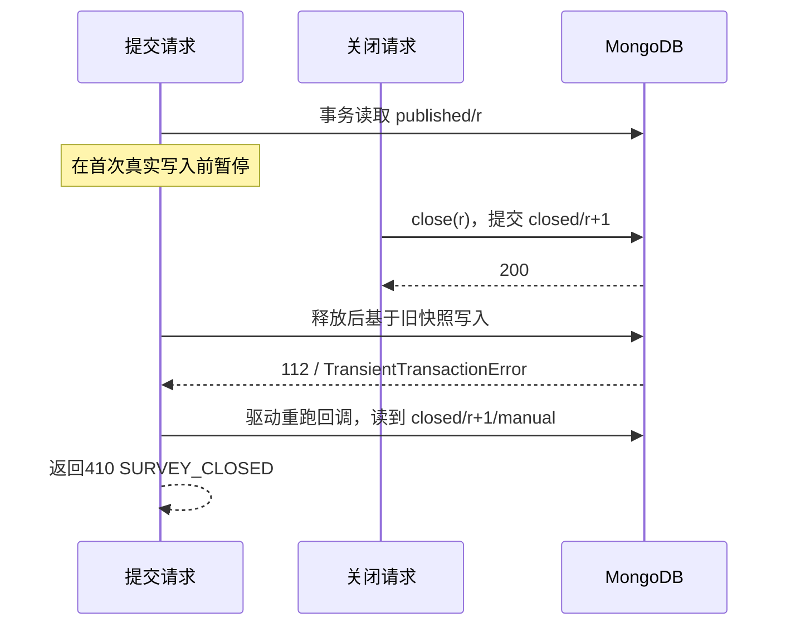

# 问序｜关闭与提交竞争专项

日期：2026 年 10 月 19 日。覆盖组 `CONS-04`，验证两个请求在指定位置交错时的手动关闭与提交结果。实际结果及原始证据集中见[执行结果第 1 节](03_执行结果.md)。

## 1 入口与前提

源码：[test_consistency.py](../01_代码/backend/tests/test_consistency.py)。

| 顺序 | 测试函数 |
|---|---|
| 关闭先完成 | `test_manual_close_wins_before_transaction_write` |
| 提交先完成 | `test_committed_submission_makes_paused_close_revision_stale` |

每个入口按匿名／实名、允许／禁止重复展开四项，共八项。真实隔离副本集中，目标问卷已发布、`deadlineAt=null`、没有既有答卷，凭据来自 `start`；另一份已有答卷和参与记录的问卷作不变对照。下文计数只针对目标问卷，`r` 为初始 revision。

## 2 关闭先完成：旧快照写冲突与事务重试



包装 `Collection.find_one` 观察事务读取，包装 `update_one` 在第一次原方法调用前暂停；关闭落库后释放。原 PyMongo 方法真实抛出的冲突只作记录，随后原样抛回驱动，未伪造结果或异常。

断言暂停点命中且提交尚未结束、初次读为 `published/r`、异常码与标签正确、同一会话回调确实重试。关闭只改允许字段和 revision；最终 0 答卷、0 参与，拒绝后的全库快照等于关闭成功时的快照。

## 3 提交先完成：旧关闭条件失效

1. 关闭请求真实读取 `published/r` 并通过权限及版本检查，在原子条件更新前暂停。
2. 提交事务返回 201，问卷变为 `published/r+1`。
3. 释放关闭，原 `find_one_and_update` 按旧 `revision=r` 更新无匹配；返回 409 `REVISION_CONFLICT`，全库保持提交后的快照。
4. 创建者 GET 最新版本再关闭，得到 `closed/r+2`，已有答卷与参与记录不变。
5. 原 key、原答案重试返回 201 确认，关闭后快照不变。

这是旧版本条件更新（CAS）真实失效的证据，未测量 MongoDB 持锁时的服务端等待。它与截止前在途模拟 TIME-03、同／不同 key 并发 CONCUR 组分别验证不同规则。

## 4 四策略组合与数据断言

| 参数 ID | 匿名 | 允许重复 | 关闭先完成：答卷／参与 | 提交先完成：答卷／参与 | 成功答卷身份 |
|---|---|---|---|---|---|
| `no-repeat-named` | 否 | 否 | 0／0 | 1／1 | 当前填写者 `respondentId` |
| `no-repeat-anonymous` | 是 | 否 | 0／0 | 1／1 | 省略 `respondentId` |
| `repeat-named` | 否 | 是 | 0／0 | 1／0 | 当前填写者 `respondentId` |
| `repeat-anonymous` | 是 | 是 | 0／0 | 1／0 | 省略 `respondentId` |

成功后检查答卷 `_id`、key、规范答案、提交时间、结构版本，以及参与记录三个允许字段；后续关闭失败、成功关闭和确认重试均不改写。无关问卷、答卷、参与记录及全部账号始终不变。

## 5 调度与时序证据

`threading.Event` 控制暂停与释放，线程安全 first-call 标记防止事务重试再次暂停。包装按测试 MongoClient、库、集合、目标问卷及 session／关闭更新内容筛选，其余调用执行原方法。等待上限 5 秒，失败时 `finally` 释放并等线程退出，再恢复包装与清理测试库。

八条时序以 JUnit 属性 `race.close_wins.anonymous_{false|true}.repeat_{false|true}` 或 `race.submit_wins.anonymous_{false|true}.repeat_{false|true}` 记录阶段、状态、revision、错误及计数，不含账号、文档 ID、答案或凭据。[受控时序 JSON](证据/关闭提交竞争专项/受控时序记录.json)供核对，最终结论仍由断言和 JUnit 确定；不推广为穷尽所有线程交错。

## 6 专项复现

依赖准备及完整套件命令见[测试入口](README.md)。只运行本专项时，在 `01_代码/backend` 执行：

```powershell
.venv/Scripts/python.exe -m pytest tests/test_consistency.py -k "test_manual_close_wins_before_transaction_write or test_committed_submission_makes_paused_close_revision_stale" -q --junitxml=../output/close-submit-targeted.xml
```

测试使用既有隔离 fixture，不读取真实配置，不修改业务应用或 Schema。